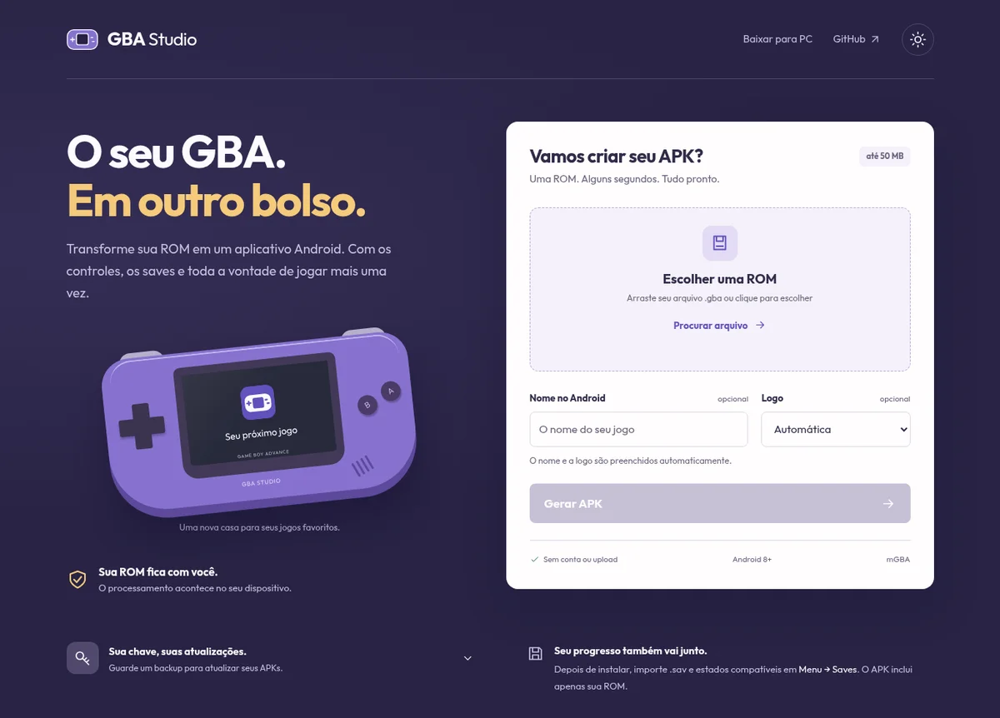

<div align="center">


# GBA Studio

**Sua ROM de GBA. Seu aplicativo Android.**

Selecione o jogo, personalize e baixe o APK — direto no navegador ou offline no computador.

[Abrir o gerador](https://willianbr08.github.io/PortGBA-Mobile/) · [Linux AppImage](https://github.com/WillianBr08/PortGBA-Mobile/releases/latest/download/GBA-Studio-linux-x64.AppImage) · [Windows EXE](https://github.com/WillianBr08/PortGBA-Mobile/releases/latest/download/GBA-Studio-win-x64.exe)



</div>

## Do arquivo ao APK

1. Selecione uma ROM **`.gba` de até 50 MB** descompactada.
2. Se quiser, escolha o nome e a logo: Automática, Emerald, FireRed ou GBA.
3. Clique em **Gerar APK**, baixe e instale no Android.

Não precisa de conta, Java ou SDK para usar. A ROM e a chave de assinatura são processadas localmente; o site baixa somente bases Android estáticas. Não há upload de jogos ou saves.

**Compatibilidade:** 50 MB significa 50.000.000 bytes. O arquivo é preservado integralmente no APK, mas o mapeamento comum do núcleo GBA alcança **32 MiB**. ROMs maiores recebem um aviso e podem não funcionar. O APK suporta Android 8+, ARM64, ARMv7 e x86_64; desempenho depende do jogo e do aparelho.

## Use também offline

| Plataforma | Download | Como abrir |
| --- | --- | --- |
| Linux x64 | [GBA-Studio-linux-x64.AppImage](https://github.com/WillianBr08/PortGBA-Mobile/releases/latest/download/GBA-Studio-linux-x64.AppImage) | Dê permissão de execução e abra o arquivo. |
| Windows x64 | [GBA-Studio-win-x64.exe](https://github.com/WillianBr08/PortGBA-Mobile/releases/latest/download/GBA-Studio-win-x64.exe) | Abra o executável portátil; não precisa instalar. |

Os pacotes já incluem as bases Android e funcionam sem internet. No Linux, use `chmod +x GBA-Studio-linux-x64.AppImage`. Se o sistema não tiver FUSE, execute com `--appimage-extract-and-run`. O EXE não tem assinatura comercial de editor e pode exibir o aviso de aplicativo desconhecido do Windows. Confira os hashes na [release](https://github.com/WillianBr08/PortGBA-Mobile/releases/latest).

## Guarde a chave, preserve seu progresso

Na primeira geração, uma chave local é criada para assinar seus APKs. Use **Exportar backup** e guarde o backup: ele contém a chave privada sem senha. Para usar a mesma identidade em outro navegador ou no aplicativo desktop, restaure esse backup.

A mesma ROM e a mesma chave permitem atualizar o aplicativo, inclusive após mudar nome ou logo. Alterar a ROM muda seu identificador. Limpar dados do navegador, mudar de perfil ou usar outra chave pode impedir atualizar por cima. Exporte seus saves antes de desinstalar.

No aplicativo Android, use **Menu → Saves** para importar ou exportar `.sav` e estados mGBA. O APK gerado no site não inclui saves pessoais. Os aplicativos web/desktop têm identificação própria e podem coexistir com os do gerador Linux legado.

## Dentro do projeto

```text
android/app/          Interface Android, controles e integração nativa
web/                  Site, montagem ZIP, assinatura v2 e testes
desktop/             Aplicativo offline e empacotamento Linux/Windows
tools/               Preparação das bases e gerador Linux legado
tests/android/       Verificação dos controles
vendor/patches/       Patch local sobre o núcleo mGBA fixado
docs/                Desenvolvimento, validação e decisões
.github/workflows/   Publicação do site e releases desktop
```

O núcleo mGBA é obtido por commit fixado durante o build em `build/mgba/`; dependências, builds e arquivos pessoais ficam fora do Git. O projeto é independente da pasta de jogos do Elite Redux.

## Desenvolvimento e publicação

Consulte [como compilar e testar](docs/development.md), [validações e limites](docs/testing.md) e [escopo da entrega](docs/spec.md).

O GitHub Actions prepara bases sem ROM, verifica os APKs e publica o site no Pages. Tags `v*` também compilam e testam os pacotes Linux/Windows e publicam uma release com SHA-256. A variável `GBA_STUDIO_PUBLISH=true` habilita o deploy do Pages; a origem deve ser **GitHub Actions** em Settings → Pages.

O gerador Linux por linha de comando continua disponível: `./portar-gba.sh /caminho/Jogo.gba --title "Meu jogo" --logo auto`. Sem argumentos, abre a interface Tk do sistema. Requer as ferramentas Android descritas na documentação.

## Licenças

O código próprio segue a [MIT](LICENSE). O núcleo [mGBA](https://github.com/mgba-emu/mgba) tem licença MPL-2.0; veja [dependências e patch](vendor/README.md). Fontes e demais licenças acompanham os arquivos publicados. ROMs, saves e chaves pessoais não são distribuídos.
